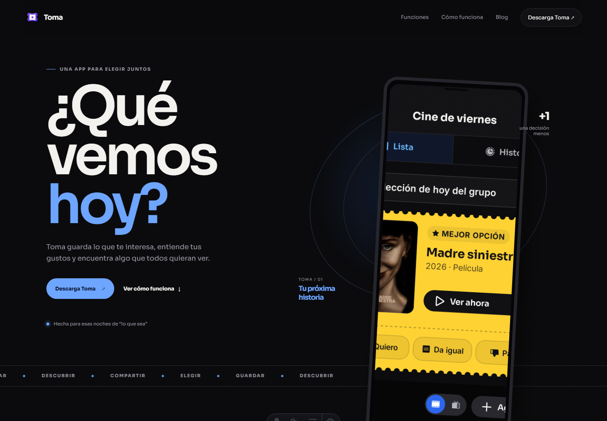

# Toma landing

Landing estática para Toma, construida con Astro.



La landing usa la identidad de la app: modo oscuro, cobalto con la nube de pixeles (port de `PixelCloud.kt`), el boleto amarillo, iconos Phosphor y capturas reales de la app (Sora + Inter, paleta de `TomaColors`).

## Títulos de TMDB

Los pósters y fondos de «Descubre», «Tendencias» y el muro de pósters salen de TMDB y viven en `public/images/posters/`, con sus datos en `src/data/titles.json`. Para actualizarlos, vuelve a consultar la tendencia de la semana con el `TMDB_READ_TOKEN` del backend y reemplaza ambos. El pie de página lleva la atribución que exige TMDB.

## Desarrollo

```bash
npm install
npm run dev
```

## Producción

```bash
npm run build
npm run preview
```

El resultado estático se genera en `dist/`. En Cloudflare Pages, usa `npm run build` como comando y `dist` como directorio de salida.

## Blog

Los artículos viven en `src/content/blog/*.md`. El panel editorial está en `/admin/` y está preparado para Decap CMS con el backend de GitHub. Antes de usarlo, cambia `TU_USUARIO/toma-landing`, `site_domain` y `base_url` en `public/admin/config.yml`.

## Pendientes antes de producción

- Sustituir los enlaces y datos de las páginas legales por la versión revisada.
- Cambiar `PUBLIC_SITE_URL` por el dominio real.
- Confirmar la URL final de Google Play.
- Configurar OAuth de GitHub para Decap CMS si el dominio usa autenticación propia.
